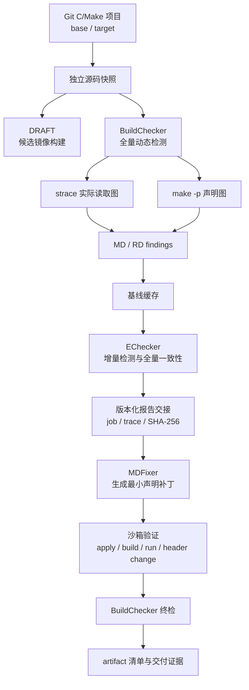

# DevOps 课程期末项目报告（初稿）

> 2026 年秋季学期 · A 组 · A 轨道（BuildChecker → EChecker）  
> 项目名称：BuildChecker 构建依赖检测、增量修复与交付流水线  
> 成员：241880267 丁宣中、241880408 刘智健、241880536 姚晟易  
> 主仓库：<https://github.com/Edison0825/devops-buildchecker>  
> E2–E4 前期仓库：`https://git.nju.edu.cn/IseRrat/devops.git`（校内访问）  
> 候选版本：`v0.9-rc`（指向 `b84b87bada9ee6af013efa3a5f0e11817ff7ef02`）

> **证据口径：**本文汇总 BuildChecker 项目 E2–E14 的已提交材料；第一次 Spring/Vue DevSecOps 作业仅作为前置实践列入附录。运行次数、退出码、任务号、镜像 ID 和结果均来自既有报告及归档原件；期末整理没有重跑历史实验。服务器 `work/` 默认不进入 Git，证据归档与哈希见[期末证据收集清单](期末证据收集清单.md)。

## 1. 项目概述与完成目标

### 1.1 背景与问题

Make 通过依赖声明决定哪些目标需要重建。如果源码在编译时实际读取了头文件，而 Makefile 没有声明该依赖，头文件变化后可能不会触发重建，形成 **MISSING Dependency（MD）**；反之，声明了本次构建没有实际读取的依赖，则形成 **REDUNDANT Dependency（RD）**，可能造成不必要的重建。

本项目以 C/Make 项目为对象，将课程各阶段串成一条工程主线：

1. 先定义异步 Job、artifact 和 A/B 组件接口契约，并建立可重复容器环境；
2. 采集 clean build 的实际文件访问和 Make 声明；
3. 对比两张依赖图，输出带证据的 MD/RD；
4. 在版本变化后增量更新依赖图，并与全量结果比较；
5. 根据 MD 生成最小 Makefile 补丁，在沙箱中构建、运行和复检；
6. 将 DRAFT、BuildChecker、EChecker、MDFixer 组合成可追踪的五阶段流水线；
7. 通过 API、跨组交接、CI 门禁和四服务 Compose 部署形成候选交付。

### 1.2 完成范围

| 状态          | 内容                                                                                                                                                                                                                                                                               |
| ------------- | ---------------------------------------------------------------------------------------------------------------------------------------------------------------------------------------------------------------------------------------------------------------------------------- |
| 已完成        | E2 异步 Job 与组件接口契约；E3 并行测试夹具与人工 oracle；E4 可重复容器环境；E5 动态证据采集；E6 自动 MD/RD 检测；E7 质量门禁；E8–E10 增量分析、补丁和矩阵验证；E11–E12 五阶段流水线、API 和真实项目泛化；E13 C1–C8、教师项目和双向跨组测试；E14 四服务 E2E、故障注入、恢复和 CI。 |
| 已归档        | 267 的 E5–E14 个人证据、组级 E13–E14 核心证据以及 E2–E4/早期材料已形成带内外层 SHA-256 的离线包；GitHub CI 日志和最新 B04 闭环原件仍需并入最终总包。                                                                                                                               |
| 部分完成      | `v0.9-rc` 已存在，代码级阻断缺陷已关闭，B04 双向项目闭环已由 PR #29 补入；旧组级候选说明仍保留“待 B 方项目”的历史判定，正式发布状态需负责人用最新证据更新。                                                                                                                        |
| 未完成/不宣称 | 不支持所有 Make 语法、递归 Make、多输出 job、符号链接和所有构建系统；不宣称完整复现论文原型或达到论文性能。                                                                                                                                                                        |

### 1.3 E2–E14 演进

| 阶段    | 工程目标与结果                                                                                                                                          |
| ------- | ------------------------------------------------------------------------------------------------------------------------------------------------------- |
| E2      | 定义统一异步 Job、artifact URI 和 A/B 组件 Schema；提供 FULL_CHECK、INCREMENTAL_CHECK、DRAFT、REPAIR 接口及校验器。                                     |
| E3      | 建立 MD/RD 人工 oracle、C0/C1/C2 增量夹具、固定 MD、参考/无效补丁和 DRAFT 失败候选；当时尚未声称工具本体已经接入。                                      |
| E4      | 固化 Dockerfile、Compose、Makefile、锁文件和 README；`featureA@dfa7693d…` 上 `make all` 通过，3 项测试、smoke 和密钥检查成功，并由 241880408 独立重跑。 |
| E5–E7   | 从手工 `strace + make -p` 证据发展为自动检测器和受保护分支质量门禁。                                                                                    |
| E8–E10  | 增量缓存、补丁生成、修复验证及 30 行增量/全量一致性矩阵。                                                                                               |
| E11–E12 | 组件集成、五阶段流水线、HTTP API、SDS 真实项目泛化和首次跨组联调。                                                                                      |
| E13–E14 | 报告交接、故障矩阵、教师项目、双向真实项目测试、四服务部署和候选发布。                                                                                  |

第一次作业中的 Spring/Vue GitLab CI 覆盖 Build、Unit Test、Code Quality、SAST、Dependency Scanning 和 Deploy，是本课程早期 DevSecOps 实践；由于它不是 BuildChecker 项目本体，本文只在附录索引其截图和提交说明，不把两者的功能成果混合统计。

## 2. 系统设计与核心实现

### 2.1 总体架构



E12 的进程内五阶段顺序为：

```text
draft → full-check → incremental-check → repair → recheck
```

E14 将上述职责拆成四个 HTTP 服务：

| 服务           |          默认端口 | 责任与权限                                       |
| -------------- | ----------------: | ------------------------------------------------ |
| `buildchecker` | `127.0.0.1:18081` | 全量动态检测；获得 `SYS_PTRACE`。                |
| `echecker`     | `127.0.0.1:18082` | 增量扫描，并与全量对象目标图比较。               |
| `draft`        | `127.0.0.1:18083` | 构建候选镜像；四个角色中仅它挂载 Docker socket。 |
| `mdfixer`      | `127.0.0.1:18084` | 校验报告、生成补丁并执行沙箱验证。               |

Compose 对服务设置 CPU、内存、PID、健康检查和 `no-new-privileges`。主要实现位于 `services/buildchecker/`、`labs/e8e10/`、`labs/e11e12/` 和 `labs/e13e14/`。

### 2.2 BuildChecker 的动态证据链

`full_check()` 将 E5 手工流程程序化：

1. 复制输入项目到独立目录，并记录输入文件 SHA-256；
2. 执行 clean；
3. 运行 `strace -ff -e trace=%file,%process make -p`；
4. 由进程树、成功只读打开和最终写入构造实际依赖图；
5. 解析 `make -p` 的 `# Files` 段构造声明图；
6. 计算 `MISSING = actual - declared`、`REDUNDANT = declared - actual`；
7. 保存 trace 行、Make 数据库行、输入哈希及 JSON 结果。

实现有意采用“无法可靠建模就显式拒绝”的策略。例如递归 Make、多最终输出、符号链接或不支持的路径语义返回 `UNSUPPORTED`，而不是静默产生可能错误的结论。这一取舍降低了覆盖范围，但提高了教学场景中的可解释性和证据可信度。

### 2.3 增量扫描与补丁验证

E8–E10 使用 GCC `-MM -MT` 生成对象目标的实际头文件依赖。缓存键包含本地 C/H 文件预处理指令、Make recipe、CFLAGS 和 GCC 版本。键未变化时复用旧图，否则刷新目标。报告同时给出 `added`、`resolved`、`reused` 和 `refreshed`。

补丁生成只修复 MD，不自动删除 RD，避免删除具有配置条件或未来用途的声明。候选补丁先在沙箱执行：

- `git apply --check` 与应用补丁；
- clean/build；
- 运行程序并核对输出；
- 修改头文件后验证增量重建；
- 再次扫描，确认 MISSING 清零；
- 任一步失败则回滚，原项目保持不变。

### 2.4 版本化 artifact 与接口契约

E11–E14 的结果信封包含 `schema_version`、`job_id`、`trace_id`、`kind`、`commit`、`status`、`data` 和 `artifacts`。每个 artifact 使用 `artifact://<job>/<path>` 标识，并记录字节数和 SHA-256。

流水线检查 schema、提交版本、阶段状态、artifact 类型和哈希；repair 必须消费当次 incremental-check 报告，recheck 必须对应同一目标提交。API 还覆盖幂等键、输入冲突、路径越界、artifact 下载哈希和服务重启后的状态恢复。

## 3. DevOps 工程实践

### 3.1 版本管理与协作

项目使用 GitHub 分支、PR 和受保护的 `main`。关键阶段记录包括：

- E7：PR #1、#2、#3、#4，演示正常合并、必需检查失败和恢复；
- E8–E10：PR #10、#11 合并成员扩展测试，冲突经 rebase 和复测解决；
- E11–E12：PR #14、#16、#17、#18、#20 汇集泛化、契约测试和跨组记录；
- E13–E14：Issue #24、#25 记录真实缺陷，PR #26 完成修复并进入 RC；
- PR #29 补充 B04 对 A04 反向测试包的验收与 B 侧修复重检结果。

`main` 启用必需检查、strict 模式和管理员约束，禁止直接绕过门禁。E7 曾故意写错测试预期，CI 出现 `1 failed, 18 passed` 并阻止合并；恢复后 `19 passed`。该案例证明分支保护有效，但不是算法缺陷修复。

### 3.2 构建与依赖管理

项目固定 Python 基础镜像 digest，并在不同阶段构建课程镜像。构建依赖主要包括 Python 3.13、Docker、Compose、GNU Make、GCC、Git 和 strace。后续阶段优先使用脚本入口，避免旧 Makefile/Compose 与课程镜像标签混淆。

主要命令如下：

```bash
# E5–E7
python3 scripts/lab_cloud.py e5 --out work/e5-01 --image course1020-buildchecker:<学号>
python3 scripts/lab_cloud.py e6 --out work/e6-before --image course1020-buildchecker:<学号>
python3 scripts/lab_cloud.py e6 --fixed --out work/e6-after --image course1020-buildchecker:<学号>

# E8–E10
python3 -m unittest discover -s labs/e8e10 -p test_profile.py -v
python3 labs/e8e10/lab.py e10 --track A --out work/A-e10

# E11–E12
python3 run_e11e12.py test
python3 run_e11e12.py prepare
python3 run_e11e12.py run --request data/integration-sample/e12.json --out work/e12

# E14 四服务
export E14_ROOT="$PWD" E14_IMAGE=course-e11e12:<学号>
docker compose -f labs/e13e14/compose.yaml up -d --wait
python3 labs/e13e14/orchestrate.py --request data/integration-sample/e12.json --out work/e14
docker compose -f labs/e13e14/compose.yaml down
```

### 3.3 测试与质量保障

测试从算法单元测试逐步扩展到合同、矩阵、真实项目和故障注入：

- E7：正常缺陷、修复结果、构建失败、不支持形状和超时；
- E8–E10：已知依赖、缓存复用/失效、旧报告、不安全路径、深层 include 和增量/全量一致性；
- E11–E12：schema、commit、artifact 哈希、幂等、路径边界和真实项目泛化；
- E13–E14：报告交接、哈希篡改、对象目标投影、四服务接口、失败隔离和恢复。

组级 E8–E10 记录显示 12 项测试通过，E10 六场景各 5 次共 30 行，增量结果与全量结果 30/30 相等。E11–E12 的主线 CI 后记录为 25 项通过。E13–E14 的 PR #26 及合并后工作流均成功；最新 PR #29 的 10 项检查也全部通过。

### 3.4 持续集成与交付

仓库包含四套工作流：

- `.github/workflows/e7-quality-gate.yml`
- `.github/workflows/e8e10.yml`
- `.github/workflows/e11e12.yml`
- `.github/workflows/e13e14.yml`

CI 依次执行语法检查、单元/合同测试、源码及历史密钥扫描、镜像构建、两轨实验或五阶段 E2E，并在成功或失败时上传证据。E13–E14 将 `contracts` 与 `four-services` 分成独立 job，以区分静态契约失败和部署链路失败。

期末归档使用 GitHub CLI/API 核对并离线保存了 25 个关键 Actions run，覆盖 PR #9、E11–E12、PR #26、合并后 main 和 PR #29：25/25 结论为 `success`，25/25 完整 job 日志可读取；20 个仍在保留期内的 artifact 全部下载。5 个早期 run 的 artifact 已过期或无 artifact，因此保留 run/jobs JSON 和完整日志，并在归档汇总中明确记录，不将其写成已下载。离线包 `final-evidence-github-ci.tar.gz` 内部 4660 项哈希全部通过。

候选标签 `v0.9-rc` 指向 PR #26 合并提交。代码级阻断缺陷已经修复；最新 B04 证据补齐双向正常项目的检测、接收、修复和重检。由于组级候选说明仍保留补证前的“候选待发布”文字，本文不擅自宣布正式发布，最终状态由负责人复核更新。

## 4. 功能验证与项目结果

### 4.1 教学样例：识别 MD/RD

| 项目 | 内容                                                                                                      |
| ---- | --------------------------------------------------------------------------------------------------------- |
| 输入 | `main.c` 实际包含 `config.h`；Makefile 声明 `main.o: main.c unused.h`。                                   |
| 预期 | `MISSING main.o/config.h`，`REDUNDANT main.o/unused.h`。                                                  |
| 实际 | E5 trace 记录成功只读打开 `config.h`；E6 before 得到两条 findings，CLI 在 `--fail-on-findings` 下返回 1。 |
| 修复 | 仅将 Makefile 声明改为 `main.o: main.c config.h`，源码与头文件哈希不变。                                  |
| 复检 | E6 after `findings=[]`，CLI 返回 0，校验结果 `changed_inputs=["Makefile"]`。                              |
| 证据 | `docs/E5_A_BuildChecker_复现说明.md`、`docs/E6_A_BuildChecker_MVP说明.md`。                               |

### 4.2 增量一致性

E9 的代表性序列为：C0 全量建立基线；C1 只改函数体，两目标复用且 findings 不变；C2 新增 include，两目标刷新并新增 `MISSING extra.h`；C3 补声明后实际图复用，MD 被 resolved，仅保留 RD。E10 对六类场景各运行五次，`gate.json` 记录 `passed=true, rows=30`。

证据：`docs/组级验证记录.md`。

### 4.3 真实项目 SDS

组内将 `antirez/sds` 整理为课程适配的 base/target：target 新增 `sdslog.h`，但故意未同步 Makefile。系统精确发现 `MISSING sds-test/sdslog.h`，补丁将其加入 `sds-test` 的前置依赖；46 项 SDS 测试、头文件变化验证和最终 full-check 均通过。该缺陷是组内受控构造，不是上游历史 bug。

证据：`docs/students/241880536/e11-e12/个人报告.md`、`docs/students/241880408/e11-e12/真实项目复现.md`。

### 4.4 教师项目与跨组闭环

241880267 在 Linux 上运行 jsmn、inih、tiny-AES-c 三个教师项目，三项均完成五阶段，补丁被接受，重检无 `MISSING`；每项复核 177 条 artifact。

双向跨组链路包括：

- B04 消费 A04 的 SDS 报告并成功修复，`accepted=true`，无剩余 `MISSING`；
- A04 对 B04 的 C/Make 项目检测出两项 MD（`helper.o/b04-settings.h`、`main.o/config.h`）和一项 RD（`main.o/unused.h`），与对方预期一致；
- B04 核验 A04 回传包中的 87 条 artifact 和 34 份源码副本，并使用当次报告完成 B 侧修复与重检；任务 `job-e0e6e6e0c42047c5959d79aa42242cf5`，`accepted=true`，`remaining_MISSING=0`。

证据：`docs/students/241880267/e13-e14/交叉测试记录.md`、PR #29。

## 5. 项目问题、迭代与反思

### 5.1 报告被改动后仍可能被消费（Issue #24）

**现象：**E11-B 原实现按路径读取固定 MD 报告，只检查 schema、kind 和 commit。给报告末尾增加换行后，语义字段未变，流程仍成功。

**定位：**跨组报告缺少传输层字节完整性验证，身份字段不能证明文件与发送方交付的字节一致。

**修复：**请求增加 `fixed_report_sha256`；解析 JSON 前先对原始字节计算 SHA-256；不一致返回 `ARTIFACT_HASH_MISMATCH`；E14 服务复用相同校验函数，并新增正常和篡改报告回归测试。

**验证：**修复前篡改输入 `SUCCEEDED`；修复后同场景 `FAILED` 且错误码正确。剩余风险是兼容旧请求时若调用方不提供哈希，只能执行原身份字段检查。

### 5.2 链接目标被误作编译对象（Issue #25）

**现象：**BuildChecker 动态图包含链接目标 `app`，GCC `-MM` 只产生对象目标。E14 直接比较两图，固定样例在 incremental-check 报 `Baseline BuildChecker/GCC graph mismatch`。

**定位：**比较两种证据前没有投影到共同的“对象目标”语义域。

**修复：**`object_targets()` 只保留 GCC 扫描目标与 BuildChecker 图目标的交集；编排器使用 `compile_pairs()` 检查项目形状，并把链接目标、构建命令和头文件参数传给各服务；补充链接目标剔除、真实单对象项目和无交集拒绝测试。

**验证：**固定样例由增量阶段失败恢复为五阶段成功，SDS 真实项目也完成五阶段。该问题说明跨组件集成不能只校验 JSON 结构，还必须统一数据语义。

### 5.3 当前局限

- 动态检测只覆盖单 Make 进程、单 job 单最终输出的教学档位；
- 成功 read-open 近似“发生读取”，不能证明字节级消费；
- 增量扫描主要面向显式 C/Make 规则，不支持模式规则和未建模的复杂参数；
- Docker socket 是高权限接口，目前限制在 draft 服务，但仍需在生产化方案中进一步隔离；
- 多数原始证据位于服务器 `work/`，若只保留报告路径，长期可审计性受服务器生命周期影响；
- 组级发布说明与最新跨组回执存在时间差，说明发布判定文档也需要变更控制。

## 6. 团队分工与个人贡献

| 成员             | 主要贡献                                                                                                                                                                                                                                                                                                                                               | 可核查记录                                                                                                                              |
| ---------------- | ------------------------------------------------------------------------------------------------------------------------------------------------------------------------------------------------------------------------------------------------------------------------------------------------------------------------------------------------------ | --------------------------------------------------------------------------------------------------------------------------------------- |
| 241880267 丁宣中 | E4 个人环境运行与证据整理；E5–E7 环境核对、atomic rename 测试和门禁复验；E8–E10 运行 A 轨道并编写声明变化复用测试，30 行矩阵通过；个人文档经 PR #9 合并且 CI 4/4 成功，但该测试代码未进入主线，组级结果另以 main 复验为准；E11–E12 新增 3 项增量策略测试并完成服务器运行和跨组附件复核；E13–E14 运行基线、教师三项目、B04 反向项目并整理双向闭环回执。 | 早期离线证据包；`docs/实验报告.md`；`docs/students/241880267/e11-e12/`；`docs/students/241880267/e13-e14/`；PR #9、#16、#20、#28、#29。 |
| 241880408 刘智健 | E5–E7 复验及路径测试；E8–E10 新增间接依赖、声明变化、依赖移除和深层 include 等 4 项测试；E11–E12 新增契约测试、HTTP 验收和真实项目复跑；提供 E13–E14 初始适配分支。                                                                                                                                                                                    | `docs/students/241880408/e8-e10/`、`e11-e12/`；PR #10、#14、#18；`codex/241880408/e13-e14@f62eacae…`。E13–E14 个人报告仍待补。          |
| 241880536 姚晟易 | E5–E7 检测、门禁与组级材料；E8–E10 组级验证；E11–E12 SDS 选型、受控缺陷和泛化适配；E13–E14 C1–C8、Issue #24/#25 修复、四服务 E2E、故障恢复和候选发布组织。                                                                                                                                                                                             | `docs/组级验证记录.md`；`docs/students/241880536/`；PR #11、#26、#27；Issue #24、#25。                                                  |

共同工作通过分支、PR、CI 和交叉复核衔接。报告不把他人的服务器操作、代码提交或 B04 操作重新归属给本组成员。

## 7. 复现与使用说明

### 7.1 环境

- Linux；推荐至少 4 vCPU、8 GiB 内存、100 GiB 磁盘；
- Docker 29、Compose 2.40；
- Python 3.13、Git、GNU Make、GCC、strace；
- E11–E14 运行器要求本地 Git `user.name` 为数字学号；
- E14 draft 需要可写 Docker socket，其他服务不需要；
- 不得把真实密钥写入配置或报告。

### 7.2 最小验证路径

```bash
# 1. 运行合同测试
python3 run_e11e12.py test
python3 -m unittest discover -s labs/e13e14/tests -p 'test_*.py' -v

# 2. 启动四服务并运行固定样例
export E14_ROOT="$PWD" E14_IMAGE=course-e11e12:<学号>
docker compose -f labs/e13e14/compose.yaml -p e14 up -d --wait
python3 labs/e13e14/orchestrate.py \
  --request data/integration-sample/e12.json \
  --out work/e14-final-demo
python3 labs/e13e14/scan_runtime_logs.py work/e14-final-demo
docker compose -f labs/e13e14/compose.yaml -p e14 down
```

预期：`result.json` 为 `SUCCEEDED`，五阶段齐全，repair `accepted=true`，recheck 无 `MISSING`；artifact 的 URI、字节数和 SHA-256 可重算一致。输出目录必须是新的，避免覆盖历史证据。

## 8. AI 辅助使用说明

本项目在部分阶段使用 Claude Code、Zed AI、Codex/GPT 系列代理和 DeepSeek Harness 辅助阅读代码、起草测试、生成命令、解析附件、汇总数据和整理文档。学生负责确定任务、提供运行授权、审核修改、执行或确认服务器命令，并以测试、CI、原始日志和哈希验证结果。AI 生成内容不能替代实验执行，也不把 AI 或其他成员的操作描述为个人手工完成。

组级汇总见 `docs/AI_USAGE.md`，并保留各成员阶段记录的贡献边界。241880267 的 E13–E14 与本次期末证据整理已补入组级说明；当前仍需 241880408 确认 E13–E14 初始适配分支的 AI 使用边界，并由 241880536 补充 E11–E14 的具体工具、模型和人工审核方式。

## 9. 结论

BuildChecker 从一次 clean build 的动态证据出发，形成了“检测—增量—修复—复检—交付”的完整技术链。项目不仅输出 MD/RD，还保留输入提交、系统调用、Make 声明、job/trace 和 artifact 哈希，使结论能够追踪和复核。固定样例、SDS、三个教师项目和 B04 双向项目均有相应结果记录；两个真实集成缺陷经 Issue、修复 PR 和回归测试闭环。

当前最准确的交付状态是：**技术链路和双向交叉测试闭环已补齐，代码级阻断项为零；候选标签和 CI 已具备，但组级负责人仍需用最新 B04 回执更新旧候选发布说明，并完成服务器证据集中归档后再给出最终正式发布判定。**

## 附录 A：证据索引

| 主题                   | 路径                                                                       |
| ---------------------- | -------------------------------------------------------------------------- |
| E2–E4 前期契约与环境   | 离线包 `final-evidence-early-stages.tar.gz`；校内仓库 `IseRrat/devops.git` |
| E5 动态证据            | `docs/E5_A_BuildChecker_复现说明.md`                                       |
| E6 MVP 与修复前后      | `docs/E6_A_BuildChecker_MVP说明.md`                                        |
| E5–E7 汇总             | `docs/实验报告.md`                                                         |
| E8–E10 组级结果        | `docs/组级验证记录.md`                                                     |
| E11–E12 个人与联调材料 | `docs/students/*/e11-e12/`                                                 |
| E13–E14 双向闭环       | `docs/students/241880267/e13-e14/交叉测试记录.md`                          |
| E13 测试矩阵           | `docs/students/241880536/e13-e14/交叉测试记录.md`                          |
| 缺陷定位与修复         | `docs/students/241880536/e13-e14/缺陷Issue与修复PR.md`                     |
| E14 候选说明           | `docs/students/241880536/e13-e14/候选发布说明.md`                          |
| CI                     | `.github/workflows/`                                                       |
| 服务器及早期原件归档   | `docs/期末证据收集清单.md`                                                 |
| 前置 DevSecOps 作业    | 离线包内 Spring/Vue 提交说明与流水线通过截图                               |
